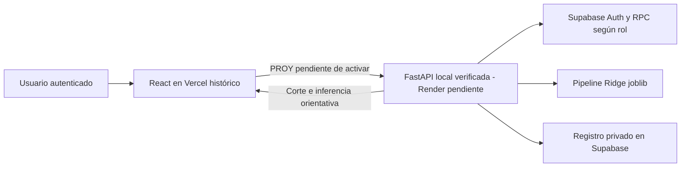

# PROY estado y verificación

Fecha: 26/11/2026. Base del checkout: `41e9b37d7840a2287a62a9d6a35b9fb1abe8b04e`.

## Implementado

- Pipeline candidato Ridge preservado con SHA256 fijo; inferencia solo del artefacto confiable.
- API autenticada: producto y semana desde cliente; sesión, rol, catálogo e historial resueltos en servidor.
- Validación por presentación y puesto; cuatro entradas finitas de 0 a 8 sacos. No se extrapola el caso 9.
- Corte como referencia operativa. Modelo solo orientativo; incertidumbre nula explicada, sin porcentaje inventado.
- Registro privado de entradas mínimas, salida, versión, hash, origen y timestamp; replay reproducible.
- React: consulta orientativa opcional por configuración para coordinación y recomendaciones de tienda.
- Pruebas locales con fixtures: 14 API, 34 frontend, 9 recorridos de Playwright. Compilación verificada.

## Aplicado en Supabase

Migraciones remotas `20261126055804_proy_forecast_service` y
`20261126060234_proy_forecast_reproducible_inputs`, reflejadas en el repositorio.
Tabla privada con RLS; escritura por RPC solo `service_role`. Se consultaron privilegios efectivos:
`anon=false`, `authenticated=false`, `service_role=true`; sin acceso directo de cliente.
La primera escritura se probó en una transacción revertida, con valores sintéticos en contexto simulado.
No es una predicción comercial ni un flujo autenticado completo en producción.

## Arquitectura prevista y estado

La nueva API no recibe variables individuales desde el navegador ni las devuelve en su respuesta.
El frontend APF3 conserva sus consultas históricas existentes. No se afirma que toda la exposición
histórica de datos haya sido sustituida por el nuevo servicio.

## Evidencias y límites

Evidencias locales bajo `output/proy/04. Pruebas y Validación` en el workspace padre.
La inferencia local incluye carga de artefacto y predicción; excluye red y servicios externos.
Playwright intercepta Supabase y API con fixtures locales, sin usar cuentas reales.
Render abre pantalla de inicio de sesión. No se configuraron claves nuevas ni se publicaron secretos.
Vercel conserva el despliegue principal histórico. La URL de Render y la activación PROY siguen pendientes.

## Cierre pendiente

1. Iniciar sesión en Render, crear servicio desde el código revisado y configurar sus secretos en canal autorizado.
2. Verificar health, Auth y roles reales; registrar una inferencia con entradas mínimas y reproducirla.
3. Configurar URL real en Vercel y verificar en el dominio principal, midiendo arranque frío y caliente.
4. Completar autorización escrita, 30 casos reales reservados y validación con dos comentarios auténticos.
5. Revisar informe, anexos IA y presentación; grabar respaldo real de máximo tres minutos después del despliegue.

El séptimo criterio de coherencia no se cumple con cero datos reales. No declarar habilitado el Paso 2b.
La mejora Ridge frente al árbol es pequeña y no supera la regla al corte.
